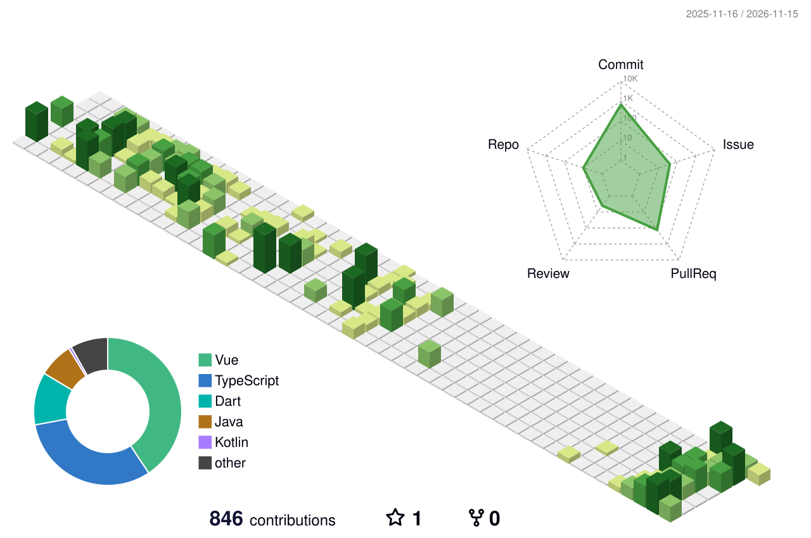

  

  <b>Full Stack Developer | Generative AI & Automation | Flutter · React · Vue.js | Java/Spring Boot · Python | Kubernetes</b>

  Open to opportunities · on-site, hybrid or remote · Londrina, PR, Brazil

  <a href="https://www.linkedin.com/in/nathan-moreno-galante-415223190">LinkedIn</a> ·
  <a href="mailto:nathanmgalante@gmail.com">nathanmgalante@gmail.com</a> ·
  <a href="README.md">Versão em português</a>

## About

Full Stack Developer with 5+ years of experience building web, mobile and back-end applications, and recent experience in AI-driven process automation.

My core is **Flutter/Dart** and **Vue.js/TypeScript**. I also build APIs with Java/Spring Boot, design PostgreSQL databases and work with React, React Native and Python.

I value well-structured code, code review and consistent standards, and I like to fully understand the business problem before building the solution.

## Highlights

| Result | How |
| --- | --- |
| **1,000+ bookings a month with no manual intervention** | Automation that detects cargo release and books the unloading slot on the right terminal or port platform, based on the destination CNPJ (Brazilian company tax ID) on the invoice, taking distance, transit time and driver rest into account. *Tarq* |
| **App used in the field without internet** | Offline-first engine with SQLite for dynamic forms and automatic background sync when a connection is detected. *Belagrícola* |
| **Automated app deployment on every merge** | GitHub Actions pipeline: on every merge, Android build to the Google Play closed testing track and iOS build to TestFlight. *Belagrícola* |
| **Kubernetes migrated from AWS to on-premise** | Took part in the migration: installed and configured the cluster on local servers and wrote the manifests (Deployments, Services, ServiceMonitors, NetworkPolicies), deployed via Argo CD. *Belagrícola* |
| **Computer vision project with YOLO** | Led the camera-based monitoring project with YOLO models chosen for reliability and cost: people and vehicle flow, area occupancy, PPE usage, fallen-person detection and early fire detection. *Tarq* |

## How I work with AI

At Tarq, development was AI-driven: I used Claude Code and Codex to generate code, critically reviewed everything generated, validated that it worked and requested adjustments.

## Experience

| Period | Where | What I did |
| --- | --- | --- |
| 07/2026 – 11/2026 | **Tarq** · AI applied to logistics | Mid-level Full Stack Developer. Monorepo with React Native, React and Python; booking automation, WhatsApp chatbot with handoff to human agents (on an n8n-style flow platform) and computer vision. |
| 02/2024 – 04/2026 | **Belagrícola** | Developer. Sole developer of the Flutter app and of the Vue.js + TypeScript front end for the pricing, sales order and customer service platforms; Java/Spring Boot APIs and PostgreSQL database from 2025; drawing of fields and areas on maps. |
| 12/2021 – 02/2024 | **Farmbits** · Belagrícola Group | IT Assistant / Developer. Lead developer of the Flutter app and the Vue.js front end; code review, coding standards and technical mentoring. |
| 05/2021 – 12/2021 | **Farmbits** | Front-end Development Intern. Web and mobile interfaces with Flutter, Vue.js and TypeScript. |
| 2020 – 2021 | **UNOPAR** | Technologist degree in Systems Analysis and Development. |

## Stack

| Area | Technologies |
| --- | --- |
| Mobile | **Flutter · Dart** · React Native |
| Web | **Vue.js · TypeScript** · JavaScript · React |
| Back-end | Java · Spring Boot · Python · RESTful APIs |
| Data | PostgreSQL · SQLite · SQL |
| AI | Claude Code · OpenAI Codex · computer vision (YOLO) · process automation |
| DevOps | Docker · Kubernetes · Argo CD · GitHub Actions · Git |

## Public projects

| Project | What it is | Stack |
| --- | --- | --- |
| [javascript-utils](https://github.com/NathanMGalante/javascript-utils) | npm package [`@nathanmgalante/n-js-utils`](https://www.npmjs.com/package/@nathanmgalante/n-js-utils) with utilities for Brazilian needs: CPF/CNPJ validation, phone number masking, file conversion and more. | TypeScript |
| [flutter-version-manager](https://github.com/NathanMGalante/flutter-version-manager) | Script to switch between Flutter versions. | Shell |
| [my-book-store](https://github.com/NathanMGalante/my-book-store) + [my-book-store-backend](https://github.com/NathanMGalante/my-book-store-backend) | Flutter app and Java REST API for the My Book Store project. | Dart · Java |

## Contact

Open to Full Stack Developer opportunities — on-site, hybrid or remote.

**Email:** [nathanmgalante@gmail.com](mailto:nathanmgalante@gmail.com) · **LinkedIn:** [nathan-moreno-galante](https://www.linkedin.com/in/nathan-moreno-galante-415223190)

  <picture>
    <source media="(prefers-color-scheme: dark)" srcset="profile-3d-contrib/profile-night-rainbow.svg">
    
  </picture>

