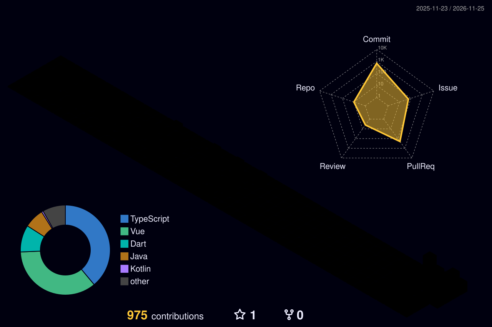

  

<h3 align="center">Nathan Moreno Galante · Desenvolvedor Full Stack</h3>

  Mais de 5 anos construindo aplicações web, mobile e back-end, com núcleo em <b>Flutter</b> e <b>Vue.js</b>. 
  Experiência recente em automação de processos com IA.

  

- **1.000+ agendamentos por mês** sem intervenção manual, com automação na Tarq
- **App Flutter offline-first** usado em campo sem internet, com sincronização automática
- **Build a cada merge** no teste fechado da Google Play e no TestFlight, com GitHub Actions
- **Visão computacional com YOLO**: liderei o projeto de monitoramento por câmeras

  <a href="https://www.linkedin.com/in/nathan-moreno-galante-415223190">LinkedIn</a> ·
  <a href="mailto:nathanmgalante@gmail.com">nathanmgalante@gmail.com</a> 
  Disponível para oportunidades · presencial, híbrido ou remoto · Londrina, PR

