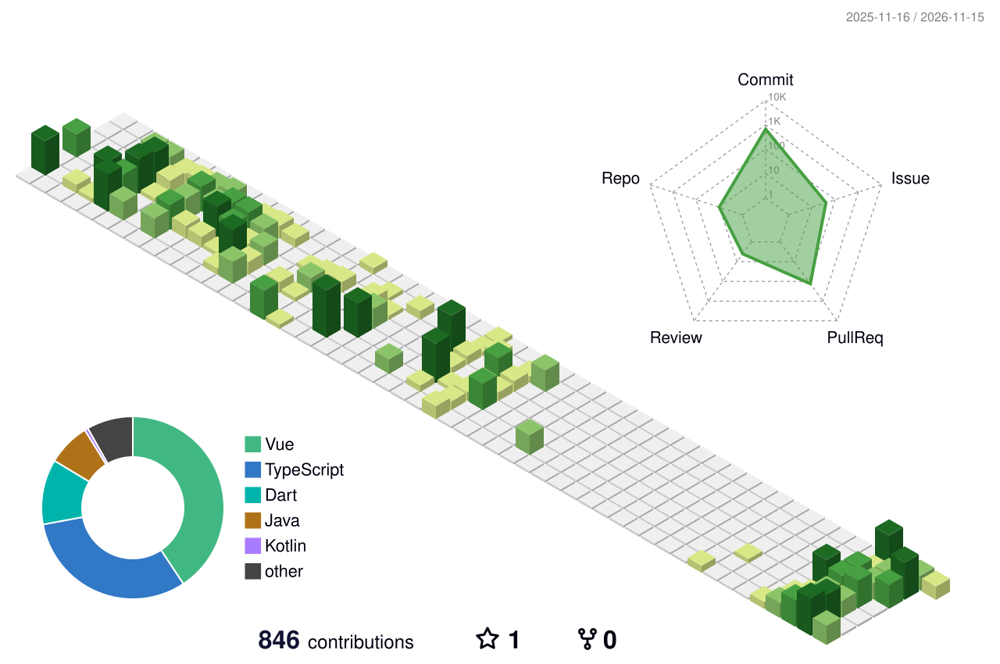

  

  <b>Desenvolvedor Full Stack | IA Generativa e Automação | Flutter · React · Vue.js | Java/Spring Boot · Python | Kubernetes</b>

  Disponível para oportunidades · presencial, híbrido ou remoto · Londrina, PR

  <a href="https://www.linkedin.com/in/nathan-moreno-galante-415223190">LinkedIn</a> ·
  <a href="mailto:nathanmgalante@gmail.com">nathanmgalante@gmail.com</a> ·
  <a href="README.en.md">English version</a>

## Sobre

Desenvolvedor Full Stack com mais de 5 anos de experiência em aplicações web, mobile e back-end, e experiência recente em automação de processos com Inteligência Artificial.

Meu núcleo é **Flutter/Dart** e **Vue.js/TypeScript**. Também construo APIs em Java/Spring Boot, modelo bancos PostgreSQL e trabalho com React, React Native e Python.

Valorizo código bem estruturado, code review e padronização, e gosto de entender a fundo o problema de negócio antes de construir a solução.

## Destaques

| Resultado | Como |
| --- | --- |
| **1.000+ agendamentos por mês sem intervenção manual** | Automação que detecta a liberação da carga e agenda a descarga na plataforma do terminal ou porto certo, pelo CNPJ de destino da nota fiscal, considerando distância, tempo de trânsito e descanso do motorista. *Tarq* |
| **App usado em campo sem internet** | Mecanismo offline-first com SQLite para formulários dinâmicos e sincronização automática em segundo plano ao detectar conexão. *Belagrícola* |
| **Deploy automatizado a cada merge** | Pipeline no GitHub Actions: a cada merge, build Android no teste fechado da Google Play e build iOS no TestFlight. *Belagrícola* |
| **Kubernetes migrado da AWS para on-premise** | Participei da migração: instalei e configurei o cluster nos servidores locais e escrevi os manifestos (Deployments, Services, ServiceMonitors, NetworkPolicies), com deploy via Argo CD. *Belagrícola* |
| **Projeto de visão computacional com YOLO** | Liderei o projeto de monitoramento por câmeras com modelos YOLO escolhidos por confiabilidade e custo: fluxo de pessoas e veículos, ocupação de áreas, uso de EPI, pessoa caída e princípio de incêndio. *Tarq* |

## Como trabalho com IA

Na Tarq, o desenvolvimento era guiado por IA: usava Claude Code e Codex para gerar o código, revisava criticamente tudo o que era gerado, validava o funcionamento e pedia ajustes.

## Trajetória

| Período | Onde | O que fiz |
| --- | --- | --- |
| 07/2026 – 11/2026 | **Tarq** · IA aplicada à logística | Desenvolvedor Full Stack Pleno. Monorepo com React Native, React e Python; automação de agendamentos, chatbot de WhatsApp com transferência para atendimento humano (em plataforma de fluxos no estilo n8n) e visão computacional. |
| 02/2024 – 04/2026 | **Belagrícola** | Desenvolvedor. Único dev do app Flutter e do front-end Vue.js + TypeScript das plataformas de preços, pedidos de venda e SAC; APIs em Java/Spring Boot e banco PostgreSQL a partir de 2025; desenho de talhões e áreas em mapas. |
| 12/2021 – 02/2024 | **Farmbits** · Grupo Belagrícola | Assistente de TI / Desenvolvedor. Dev principal do app Flutter e do front-end Vue.js; code review, padrões de código e mentoria técnica. |
| 05/2021 – 12/2021 | **Farmbits** | Estagiário de Desenvolvimento Front-end. Interfaces web e mobile com Flutter, Vue.js e TypeScript. |
| 2020 – 2021 | **UNOPAR** | Tecnólogo em Análise e Desenvolvimento de Sistemas. |

## Stack

| Área | Tecnologias |
| --- | --- |
| Mobile | **Flutter · Dart** · React Native |
| Web | **Vue.js · TypeScript** · JavaScript · React |
| Back-end | Java · Spring Boot · Python · APIs RESTful |
| Dados | PostgreSQL · SQLite · SQL |
| IA | Claude Code · OpenAI Codex · visão computacional (YOLO) · automação de processos |
| DevOps | Docker · Kubernetes · Argo CD · GitHub Actions · Git |

## Projetos públicos

| Projeto | O que é | Stack |
| --- | --- | --- |
| [javascript-utils](https://github.com/NathanMGalante/javascript-utils) | Pacote npm [`@nathanmgalante/n-js-utils`](https://www.npmjs.com/package/@nathanmgalante/n-js-utils) com utilitários para necessidades brasileiras: validação de CPF/CNPJ, máscara de telefone, conversão de arquivos e mais. | TypeScript |
| [flutter-version-manager](https://github.com/NathanMGalante/flutter-version-manager) | Script para alternar entre versões do Flutter. | Shell |
| [my-book-store](https://github.com/NathanMGalante/my-book-store) + [my-book-store-backend](https://github.com/NathanMGalante/my-book-store-backend) | App Flutter e API REST em Java do projeto My Book Store. | Dart · Java |

## Contato

Aberto a oportunidades como Desenvolvedor Full Stack — presencial, híbrido ou remoto.

**E-mail:** [nathanmgalante@gmail.com](mailto:nathanmgalante@gmail.com) · **LinkedIn:** [nathan-moreno-galante](https://www.linkedin.com/in/nathan-moreno-galante-415223190)

  <picture>
    <source media="(prefers-color-scheme: dark)" srcset="profile-3d-contrib/profile-night-rainbow.svg">
    
  </picture>

